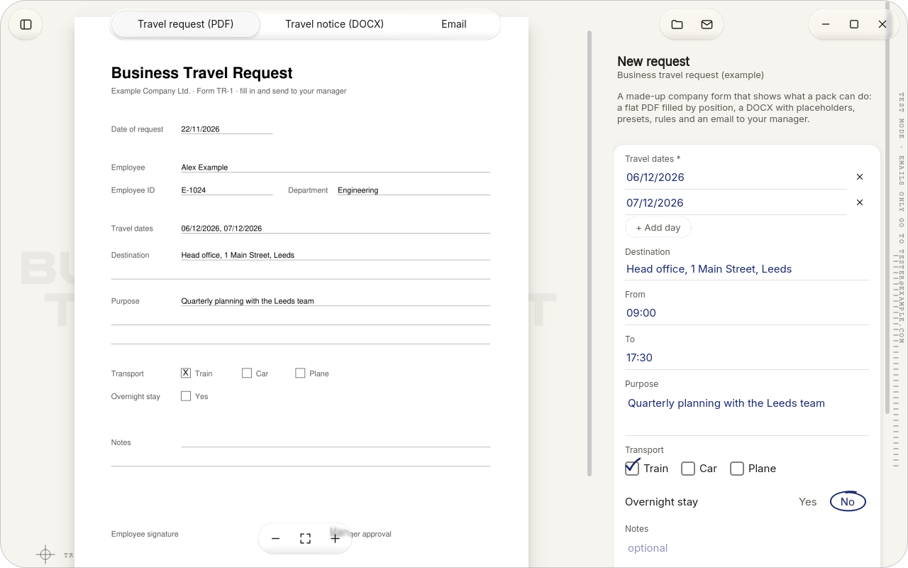
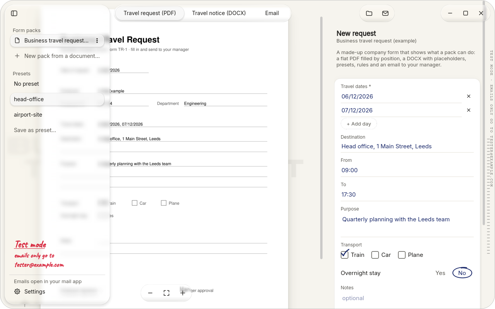
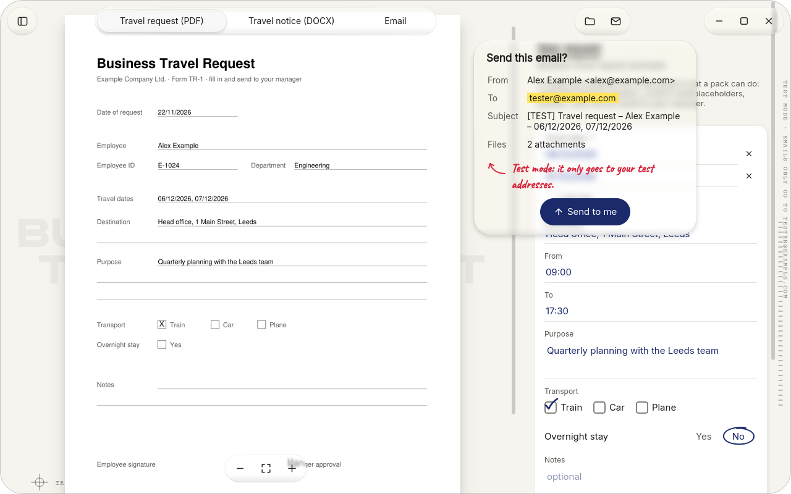

# fillmate

Fill in the same paperwork again and again? fillmate turns the forms you keep filling in
(travel requests, internship forms, expense claims, leave requests…) into a small form.
Type in what changes each time, check the preview, and send the filled PDF and Word
documents by email.



- **Form packs**: one folder with your templates and a `pack.yaml` that says what goes
  where. Share a pack as a `.zip` and a colleague with the same paperwork is ready in a
  minute. Your personal details are never part of it.
- **Any PDF**: fillable PDF forms, and flat PDFs too. Text is placed at fixed positions,
  wrapped across lines, and shrunk to fit.
- **Word documents**: `{{ placeholders }}`, or writing into table cells while the
  template's formatting stays as it is.
- **Tables**: timesheets and other ruled grids. Type the rows in a small spreadsheet with a
  fill handle. Hours and totals are computed, and extra rows go on a repeated page with its
  own totals.
- **Email**: Gmail (sign in with Google, no password stored), any SMTP server, or a draft
  opened in your own mail app.
- **Safety**: a test mode sends only to your own addresses, and a confirmation before
  each send shows exactly who gets the email.
- **Rules**: required fields, and warnings such as "less than 2 working days' notice"
  that take public holidays into account.

| Packs, presets and settings in a drawer | The check before each email goes out |
|---|---|
|  |  |

<sub>Screenshots from the demo (`tools/demo.py`), with made-up data.</sub>

## Install

```bash
pipx install fillmate      # or: pip install fillmate
fillmate                   # opens the app
```

Or download an installer (`.deb`, `.rpm`, `.dmg`, `.msi`) from the
[Releases](https://github.com/leonardonels/fillmate/releases) page. The `.deb` works on
Ubuntu 22.04 and later (`sudo apt install ./fillmate_*_amd64.deb`), the `.rpm` on Fedora
and RHEL 9 or later (`sudo dnf install ./fillmate-*.x86_64.rpm`). If apt ends with
"N: Download is performed unsandboxed as root…", that's only apt noting it couldn't read
your home folder as its `_apt` user; the install went through. The `.dmg` is for
Apple Silicon Macs (M1 and later); Intel Macs aren't supported. The macOS and Windows
builds aren't signed yet. On macOS, drag fillmate to Applications and open it; when macOS
says it can't check it, go to **System Settings → Privacy & Security** and choose **Open
Anyway** (once). On Windows, choose **More info → Run anyway**.

## First steps

1. **Settings → Form packs → Install example** gives you two demo packs. Or import a pack
   someone shared with you.
2. **Settings → Profile**: your name and the other details packs reuse.
3. **Settings → Email**: choose how to send. For Gmail, the tab has a short guide to
   create your own OAuth client (about 5 minutes, done once).
4. Pick the pack, fill in the form, press **Create documents**, check the preview and
   the email, then send.

Turn on **test mode** (Settings → General) while you try things out. Every email then
goes only to the test addresses you list.

## Make a pack for your own forms

In **Settings → Form packs → New pack from PDF…**, pick your PDF:

- If it has fillable fields, they become pack fields right away.
- If it's a flat PDF, draw a box over each blank line and click the boxes that should
  get a check mark.
- For a table, drag over it: fillmate snaps to its lines and guesses the columns (dates,
  times, hours) from the header.

For everything else (Word templates, rules, email, presets) see
[docs/pack-format.md](https://github.com/leonardonels/fillmate/blob/main/docs/pack-format.md). A pack is a folder like this:

```
my-pack/
  pack.yaml
  request.pdf
  notice.docx
```

The bundled [travel request](https://github.com/leonardonels/fillmate/blob/main/src/fillmate/examples/travel-request/pack.yaml)
uses every feature except tables. The
[timesheet](https://github.com/leonardonels/fillmate/blob/main/src/fillmate/examples/timesheet/pack.yaml)
shows tables.

## Command line

```bash
fillmate packs                                  # list installed packs
fillmate fields travel-request                  # fields, profile and presets of a pack
fillmate profile --set full_name="Jane Doe"
fillmate fill travel-request --preset head-office --set dates=2026-12-01,2026-12-02 --no-mail
fillmate fill travel-request --set dates=2026-12-01 --set destination="Leeds" --open-draft
fillmate fill timesheet --set month="November 2026" --set work=@hours.csv --no-mail
fillmate import shared-pack.zip
fillmate export travel-request travel-request.zip
```

## Where things are stored

| What | Where (Linux; macOS/Windows use their usual folders) |
|---|---|
| Settings, profile, Google sign-in | `~/.config/fillmate/` (files readable only by you) |
| SMTP password | system keyring, otherwise `~/.config/fillmate/` |
| Installed packs, saved presets, table drafts | `~/.local/share/fillmate/` |
| Filled documents | `~/Documents/Fillmate/<date>_<destination>/` |

`FILLMATE_HOME=/some/folder` keeps everything in a single folder instead.

DOCX previews, and attaching DOCX files as PDF, need
[LibreOffice](https://www.libreoffice.org/).

## Development

```bash
git clone https://github.com/leonardonels/fillmate && cd fillmate
python -m venv .venv && .venv/bin/pip install -e ".[dev]"
.venv/bin/pytest
.venv/bin/python tools/make_example_pack.py   # regenerate the example templates
.venv/bin/python tools/make_icons.py          # regenerate installer icons from the SVG
.venv/bin/python tools/demo.py                # open the app with made-up data
```

### Installers

The `.deb` and `.rpm` are made from one bundle that carries its own Python, so one file
installs on every supported release. It is built in an Ubuntu 22.04 container (needs
Docker and uv):

```bash
packaging/linux/build-linux.sh   # writes dist/fillmate_<version>_amd64.deb and .x86_64.rpm
packaging/linux/test-linux.sh    # installs them on clean Ubuntu, Fedora and AlmaLinux
```

The `.dmg` and `.msi` are built with [Briefcase](https://briefcase.beeware.org) (config
in `pyproject.toml`); the `.dmg` itself is made with dmgbuild from `packaging/macos/` (its background
comes from `tools/make_dmg_background.py`). Pushing a `v*` tag runs `.github/workflows/release.yml`, which
builds all of them plus the PyPI package and attaches them to a draft GitHub release.
Uploading to PyPI is off until the repository variable `PUBLISH_PYPI` is set to `true`.

## License

MIT
